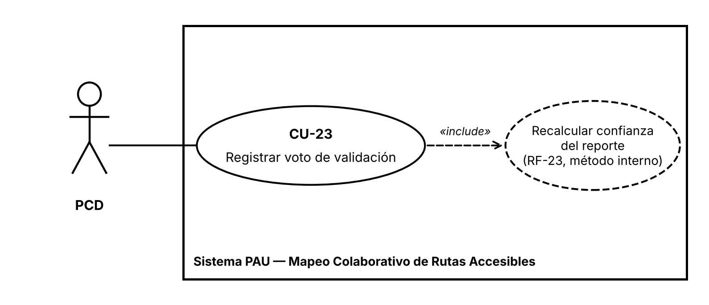
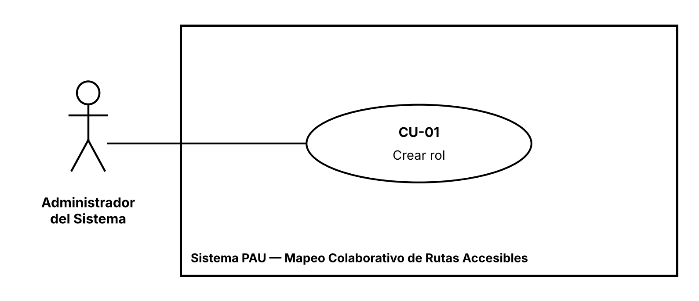
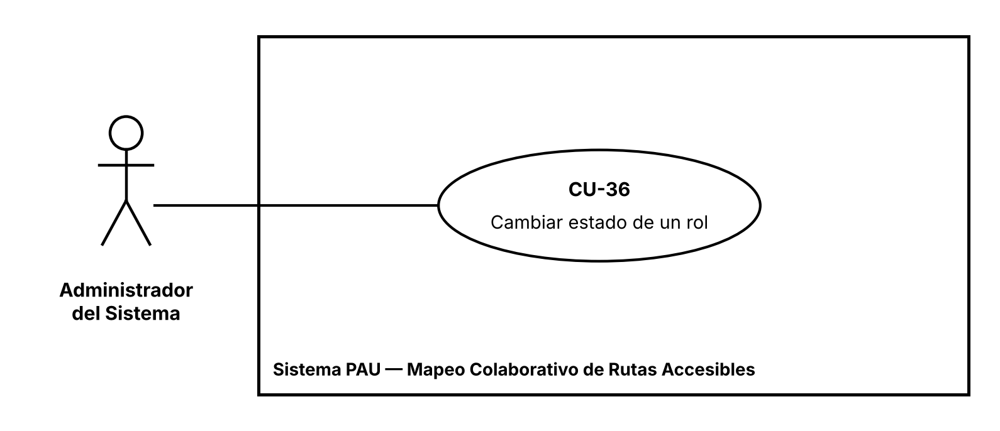

## 2.4 Casos de uso

Cada historia de usuario tiene un caso de uso con el mismo número (CU-nn corresponde a HU-nn). El actor de cada caso es el rol de su historia, y el «include» marca el comportamiento interno que dos o más casos disparan. Quedan fuera del diagrama los flujos alternos, que viven en las fichas, y el inicio de sesión como condición previa de los demás casos.

### 2.4.1 Diagramas de casos de uso

Se presentan cuatro diagramas de casos de uso, uno por caso: dos críticos, el CU-20 () y el CU-23 (), y dos no críticos, el CU-01 () y el CU-36 (). Cada diagrama muestra el actor del caso, que es el rol de su historia de usuario, y el límite del sistema. El CU-23 incluye el recálculo de la confianza del reporte (RF-23), un método interno sin historia propia. Estos cuatro casos son los que se desarrollan con diagramas de actividades, de secuencia y de estados en las secciones siguientes; los demás casos quedan documentados en sus fichas (2.4.3).

Figura  
*Diagrama de casos de uso crítico: cambiar estado del reporte (CU-20)*

*Nota.* Elaboración propia a partir de la historia HU-20.

Figura  
*Diagrama de casos de uso crítico: registrar voto de validación (CU-23)*

*Nota.* Elaboración propia a partir de la historia HU-23. El óvalo discontinuo es un caso interno (RF-23).

Figura  
*Diagrama de casos de uso no crítico: crear rol (CU-01)*

*Nota.* Elaboración propia a partir de la historia HU-01.

Figura  
*Diagrama de casos de uso no crítico: cambiar estado de un rol (CU-36)*

*Nota.* Elaboración propia a partir de la historia HU-36.

### 2.4.2 Selección de los casos críticos

Se documentaron los 34 casos de uso con la plantilla del curso y, entre ellos, se destacan seis casos críticos. Se eligieron los casos que cumplen al menos uno de estos criterios: validan una regla de negocio mediante flujos alternos que nacen de los criterios de rechazo de la historia, incluyen un comportamiento interno mediante «include», o sostienen un hallazgo principal de la encuesta. La resume la elección.

Tabla  
*Casos de uso críticos y razón de su selección*

| **Caso** | **Nombre**                    | **Justificación**                                                                                                                                                           |
|----------|-------------------------------|-----------------------------------------------------------------------------------------------------------------------------------------------------------------------------|
| CU-07    | Iniciar sesión                | Es la puerta de entrada de los tres roles. Valida la RN-03 (solo cuentas activas) y tiene tres flujos alternos: contraseña incorrecta, cuenta inactiva y cuenta suspendida. |
| CU-10    | Consultar perfil de movilidad | Maneja datos sensibles (Ley 1581 de 2012). Incluye el registro del acceso (RF-12) y valida la RN-05; se apoya en los RNF-04, RNF-05 y RNF-10.                               |
| CU-18    | Crear reporte                 | Es el origen de la información colaborativa (hallazgos H1 y H4). Valida la RN-08 con tres flujos alternos según el origen del reporte.                                      |
| CU-20    | Cambiar estado del reporte    | Propaga el cambio al estado de la barrera. Valida la RN-09, la regla de prevalencia más compleja del sistema, y se relaciona con CU-14.                                     |
| CU-23    | Registrar voto de validación  | Incluye el recálculo de la confianza del reporte (RF-23) y valida la RN-11 (un voto por usuario). Sostiene la información verificada (hallazgo H2).                         |
| CU-29    | Calcular ruta accesible       | Es la funcionalidad principal que pidió la encuesta (hallazgo H3). Valida la RN-12 (cálculo único) y está sujeto al RNF-01 (menos de 3 segundos).                           |

*Nota.* Elaboración propia.

### 2.4.3 Fichas de los casos de uso

Cada ficha toma la precondición de los antecedentes de la historia, el final del flujo básico del criterio de aceptación de éxito, y cada flujo alterno de un criterio de rechazo, con la regla de negocio que valida. Se documentan los 34 casos; los seis críticos llevan la fila «Caso crítico».

Tabla  
*Ficha del CU-01: Crear rol*

<table>
<colgroup>
<col style="width: 22%" />
<col style="width: 77%" />
</colgroup>
<tbody>
<tr class="odd">
<td><strong>Código</strong></td>
<td>CU-01: Crear rol</td>
</tr>
<tr class="even">
<td><strong>Actor</strong></td>
<td>Administrador del Sistema</td>
</tr>
<tr class="odd">
<td><strong>Precondición</strong></td>
<td>El Administrador del Sistema ha iniciado sesión.</td>
</tr>
<tr class="even">
<td><strong>Flujo básico (Evento / Respuesta)</strong></td>
<td>
1. El Administrador solicita crear un rol. / El sistema presenta el formulario de rol.

2. El Administrador ingresa nombre y descripción del rol. / El sistema recibe los datos.

3. — / El sistema verifica que el nombre del rol no esté ya registrado (RN-01).

4. — / El sistema registra el rol e informa “Rol registrado correctamente.”
</td>
</tr>
<tr class="odd">
<td><strong>Flujo alternativo 3a</strong></td>
<td>Ya existe un rol con ese nombre: el sistema no crea el rol y muestra “Ya existe un rol con ese nombre.” Vuelve al paso 2. (Valida la RN-01)</td>
</tr>
<tr class="even">
<td><strong>Poscondición</strong></td>
<td>El rol queda registrado y disponible en el catálogo para asignarse a usuarios.</td>
</tr>
</tbody>
</table>

Tabla  
*Ficha del CU-02: Consultar rol*

<table>
<colgroup>
<col style="width: 22%" />
<col style="width: 77%" />
</colgroup>
<tbody>
<tr class="odd">
<td><strong>Código</strong></td>
<td>CU-02: Consultar rol</td>
</tr>
<tr class="even">
<td><strong>Actor</strong></td>
<td>Administrador del Sistema</td>
</tr>
<tr class="odd">
<td><strong>Precondición</strong></td>
<td>El Administrador del Sistema ha iniciado sesión.</td>
</tr>
<tr class="even">
<td><strong>Flujo básico (Evento / Respuesta)</strong></td>
<td>
1. El Administrador solicita consultar un rol por su identificador. / El sistema busca el rol.

2. — / El sistema muestra su nombre y descripción.
</td>
</tr>
<tr class="odd">
<td><strong>Flujo alternativo 2a</strong></td>
<td>No existe ningún rol con ese identificador: el sistema muestra “No se encontró ningún rol con ese identificador.”</td>
</tr>
<tr class="even">
<td><strong>Poscondición</strong></td>
<td>Ninguna modificación: la consulta no cambia datos.</td>
</tr>
</tbody>
</table>

Tabla  
*Ficha del CU-03: Actualizar rol*

<table>
<colgroup>
<col style="width: 22%" />
<col style="width: 77%" />
</colgroup>
<tbody>
<tr class="odd">
<td><strong>Código</strong></td>
<td>CU-03: Actualizar rol</td>
</tr>
<tr class="even">
<td><strong>Actor</strong></td>
<td>Administrador del Sistema</td>
</tr>
<tr class="odd">
<td><strong>Precondición</strong></td>
<td>El Administrador ha iniciado sesión y el rol existe.</td>
</tr>
<tr class="even">
<td><strong>Flujo básico (Evento / Respuesta)</strong></td>
<td>
1. El Administrador selecciona un rol y solicita editarlo. / El sistema presenta el formulario con los datos actuales.

2. El Administrador modifica el nombre o la descripción. / El sistema recibe los cambios.

3. — / El sistema verifica que el nuevo nombre no coincida con el de otro rol (RN-01).

4. — / El sistema guarda los cambios e informa “Rol actualizado correctamente.”
</td>
</tr>
<tr class="odd">
<td><strong>Flujo alternativo 3a</strong></td>
<td>El nuevo nombre ya pertenece a otro rol: el sistema no aplica el cambio y muestra “Ya existe un rol con ese nombre.” Vuelve al paso 2. (Valida la RN-01)</td>
</tr>
<tr class="even">
<td><strong>Poscondición</strong></td>
<td>El rol queda con el nuevo nombre o descripción.</td>
</tr>
</tbody>
</table>

Tabla  
*Ficha del CU-04: Registrar usuario*

<table>
<colgroup>
<col style="width: 22%" />
<col style="width: 77%" />
</colgroup>
<tbody>
<tr class="odd">
<td><strong>Código</strong></td>
<td>CU-04: Registrar usuario</td>
</tr>
<tr class="even">
<td><strong>Actor</strong></td>
<td>PCD (persona que se registra)</td>
</tr>
<tr class="odd">
<td><strong>Precondición</strong></td>
<td>El rol “PCD” existe en el catálogo de roles.</td>
</tr>
<tr class="even">
<td><strong>Flujo básico (Evento / Respuesta)</strong></td>
<td>
1. La persona solicita registrarse. / El sistema presenta el formulario de registro.

2. La persona ingresa nombre, correo, contraseña y rol “PCD”. / El sistema recibe los datos.

3. — / El sistema verifica que el correo no esté ya registrado (RN-02) y que el rol esté activo (RN-15).

4. — / El sistema crea la cuenta en estado “ACTIVO” e informa “Cuenta registrada correctamente.”
</td>
</tr>
<tr class="odd">
<td><strong>Flujo alternativo 3a</strong></td>
<td>Ya existe una cuenta con ese correo: el sistema no crea la cuenta y muestra “Ese correo ya está registrado.” Vuelve al paso 2. (Valida la RN-02)</td>
</tr>
<tr class="even">
<td><strong>Flujo alternativo 3b</strong></td>
<td>El rol “PCD” está “INACTIVO”: el sistema no crea la cuenta y muestra “El rol solicitado no está disponible.” Vuelve al paso 2. (Valida la RN-15)</td>
</tr>
<tr class="odd">
<td><strong>Poscondición</strong></td>
<td>La cuenta queda creada, activa y lista para iniciar sesión.</td>
</tr>
</tbody>
</table>

Tabla  
*Ficha del CU-05: Consultar usuario*

<table>
<colgroup>
<col style="width: 22%" />
<col style="width: 77%" />
</colgroup>
<tbody>
<tr class="odd">
<td><strong>Código</strong></td>
<td>CU-05: Consultar usuario</td>
</tr>
<tr class="even">
<td><strong>Actor</strong></td>
<td>Administrador del Sistema</td>
</tr>
<tr class="odd">
<td><strong>Precondición</strong></td>
<td>El Administrador ha iniciado sesión.</td>
</tr>
<tr class="even">
<td><strong>Flujo básico (Evento / Respuesta)</strong></td>
<td>
1. El Administrador solicita consultar un usuario por su identificador. / El sistema busca el usuario.

2. — / El sistema muestra nombre, correo y estado.
</td>
</tr>
<tr class="odd">
<td><strong>Flujo alternativo 2a</strong></td>
<td>No existe ningún usuario con ese identificador: el sistema muestra “No se encontró ningún usuario con ese identificador.”</td>
</tr>
<tr class="even">
<td><strong>Poscondición</strong></td>
<td>Ninguna modificación.</td>
</tr>
</tbody>
</table>

Tabla  
*Ficha del CU-06: Actualizar datos personales*

<table>
<colgroup>
<col style="width: 22%" />
<col style="width: 77%" />
</colgroup>
<tbody>
<tr class="odd">
<td><strong>Código</strong></td>
<td>CU-06: Actualizar datos personales</td>
</tr>
<tr class="even">
<td><strong>Actor</strong></td>
<td>PCD (titular de la cuenta)</td>
</tr>
<tr class="odd">
<td><strong>Precondición</strong></td>
<td>El PCD ha iniciado sesión.</td>
</tr>
<tr class="even">
<td><strong>Flujo básico (Evento / Respuesta)</strong></td>
<td>
1. El PCD solicita editar sus datos personales. / El sistema presenta el formulario con sus datos actuales.

2. El PCD modifica su nombre o correo. / El sistema recibe los cambios.

3. — / El sistema verifica que el nuevo correo no pertenezca a otra cuenta (RN-02).

4. — / El sistema guarda los cambios e informa “Datos actualizados correctamente.”
</td>
</tr>
<tr class="odd">
<td><strong>Flujo alternativo 3a</strong></td>
<td>El correo ya pertenece a otra cuenta: el sistema no aplica el cambio y muestra “Ese correo ya está en uso por otra cuenta.” Vuelve al paso 2. (Valida la RN-02)</td>
</tr>
<tr class="even">
<td><strong>Poscondición</strong></td>
<td>Los datos personales quedan actualizados.</td>
</tr>
</tbody>
</table>

Tabla  
*Ficha del CU-07: Iniciar sesión*

<table>
<colgroup>
<col style="width: 22%" />
<col style="width: 77%" />
</colgroup>
<tbody>
<tr class="odd">
<td><strong>Código</strong></td>
<td>CU-07: Iniciar sesión</td>
</tr>
<tr class="even">
<td><strong>Caso crítico</strong></td>
<td>Es la puerta de entrada de los tres roles y valida la RN-03.</td>
</tr>
<tr class="odd">
<td><strong>Actor</strong></td>
<td>PCD</td>
</tr>
<tr class="even">
<td><strong>Precondición</strong></td>
<td>Existe la cuenta del usuario.</td>
</tr>
<tr class="odd">
<td><strong>Flujo básico (Evento / Respuesta)</strong></td>
<td>
1. El usuario ingresa su correo y su contraseña. / El sistema verifica las credenciales.

2. — / El sistema verifica que la cuenta esté en estado “ACTIVO” (RN-03).

3. — / El sistema concede acceso al perfil del usuario.
</td>
</tr>
<tr class="even">
<td><strong>Flujo alternativo 2a</strong></td>
<td>La contraseña es incorrecta: el sistema rechaza el acceso y muestra “Correo o contraseña incorrectos.”</td>
</tr>
<tr class="odd">
<td><strong>Flujo alternativo 2b</strong></td>
<td>La cuenta está “INACTIVO”: el sistema rechaza el acceso y muestra “Esta cuenta está inactiva.” (Valida la RN-03)</td>
</tr>
<tr class="even">
<td><strong>Flujo alternativo 2c</strong></td>
<td>La cuenta está “SUSPENDIDO”: el sistema rechaza el acceso y muestra “Esta cuenta está suspendida.” (Valida la RN-03)</td>
</tr>
<tr class="odd">
<td><strong>Poscondición</strong></td>
<td>El usuario queda autenticado y con acceso a su perfil, o sin acceso según el resultado.</td>
</tr>
</tbody>
</table>

Tabla  
*Ficha del CU-08: Cambiar estado de una cuenta*

<table>
<colgroup>
<col style="width: 22%" />
<col style="width: 77%" />
</colgroup>
<tbody>
<tr class="odd">
<td><strong>Código</strong></td>
<td>CU-08: Cambiar estado de una cuenta</td>
</tr>
<tr class="even">
<td><strong>Actor</strong></td>
<td>Administrador del Sistema</td>
</tr>
<tr class="odd">
<td><strong>Precondición</strong></td>
<td>El Administrador ha iniciado sesión.</td>
</tr>
<tr class="even">
<td><strong>Flujo básico (Evento / Respuesta)</strong></td>
<td>
1. El Administrador selecciona un usuario y el nuevo estado (Activo, Inactivo, Suspendido). / El sistema recibe la solicitud.

2. — / El sistema verifica que el estado solicitado sea distinto del actual.

3. — / El sistema aplica el cambio de estado e informa el resultado.
</td>
</tr>
<tr class="odd">
<td><strong>Flujo alternativo 2a</strong></td>
<td>El estado solicitado es igual al actual: el sistema no aplica el cambio y muestra “El usuario ya se encuentra en ese estado.”</td>
</tr>
<tr class="even">
<td><strong>Poscondición</strong></td>
<td>La cuenta queda en el nuevo estado; si quedó “SUSPENDIDO” o “INACTIVO”, no podrá iniciar sesión (CU-07).</td>
</tr>
</tbody>
</table>

Tabla  
*Ficha del CU-09: Registrar perfil de movilidad*

<table>
<colgroup>
<col style="width: 22%" />
<col style="width: 77%" />
</colgroup>
<tbody>
<tr class="odd">
<td><strong>Código</strong></td>
<td>CU-09: Registrar perfil de movilidad</td>
</tr>
<tr class="even">
<td><strong>Actor</strong></td>
<td>PCD</td>
</tr>
<tr class="odd">
<td><strong>Precondición</strong></td>
<td>El PCD ha iniciado sesión.</td>
</tr>
<tr class="even">
<td><strong>Flujo básico (Evento / Respuesta)</strong></td>
<td>
1. El PCD solicita registrar su perfil de movilidad. / El sistema presenta el formulario.

2. El PCD ingresa tipo y grado de discapacidad, condición de movilidad, equipo de asistencia y parámetros de ruta. / El sistema recibe los datos.

3. — / El sistema verifica que el PCD no tenga ya un perfil registrado (RN-04).

4. — / El sistema registra el perfil asociado únicamente a ese usuario.
</td>
</tr>
<tr class="odd">
<td><strong>Flujo alternativo 3a</strong></td>
<td>El PCD ya tiene un perfil registrado: el sistema no crea el nuevo perfil y muestra “Ya tienes un perfil de movilidad registrado.” (Valida la RN-04)</td>
</tr>
<tr class="even">
<td><strong>Poscondición</strong></td>
<td>El perfil de movilidad queda registrado y listo para usarse en el cálculo de rutas.</td>
</tr>
</tbody>
</table>

Tabla  
*Ficha del CU-10: Consultar perfil de movilidad*

<table>
<colgroup>
<col style="width: 22%" />
<col style="width: 77%" />
</colgroup>
<tbody>
<tr class="odd">
<td><strong>Código</strong></td>
<td>CU-10: Consultar perfil de movilidad</td>
</tr>
<tr class="even">
<td><strong>Caso crítico</strong></td>
<td>Maneja datos sensibles (Ley 1581 de 2012), incluye el registro del acceso y valida la RN-05.</td>
</tr>
<tr class="odd">
<td><strong>Actor</strong></td>
<td>PCD (titular del perfil)</td>
</tr>
<tr class="even">
<td><strong>Precondición</strong></td>
<td>El PCD ha iniciado sesión y tiene un perfil de movilidad registrado.</td>
</tr>
<tr class="odd">
<td><strong>Flujo básico (Evento / Respuesta)</strong></td>
<td>
1. El PCD solicita consultar su perfil de movilidad. / El sistema recupera los datos del perfil.

2. — / El sistema muestra todos los datos del perfil.

3. — / El sistema registra internamente el acceso como “CONSULTA”, “AUTORIZADO” («include» Registrar acceso a perfil de movilidad, RF-12, RN-05).
</td>
</tr>
<tr class="even">
<td><strong>Poscondición</strong></td>
<td>El PCD ve sus datos y queda un registro de auditoría del acceso (consultable en CU-28).</td>
</tr>
</tbody>
</table>

Tabla  
*Ficha del CU-11: Actualizar perfil de movilidad*

<table>
<colgroup>
<col style="width: 22%" />
<col style="width: 77%" />
</colgroup>
<tbody>
<tr class="odd">
<td><strong>Código</strong></td>
<td>CU-11: Actualizar perfil de movilidad</td>
</tr>
<tr class="even">
<td><strong>Actor</strong></td>
<td>PCD (titular del perfil)</td>
</tr>
<tr class="odd">
<td><strong>Precondición</strong></td>
<td>El PCD ha iniciado sesión y tiene un perfil de movilidad registrado.</td>
</tr>
<tr class="even">
<td><strong>Flujo básico (Evento / Respuesta)</strong></td>
<td>
1. El PCD solicita editar su perfil de movilidad. / El sistema presenta el formulario con los datos actuales.

2. El PCD modifica uno o más datos (p. ej., distancia máxima a pie). / El sistema recibe los cambios.

3. — / El sistema guarda los cambios.

4. — / El sistema registra internamente el acceso como “MODIFICACION”, “AUTORIZADO” («include» Registrar acceso a perfil de movilidad, RF-12, RN-05).
</td>
</tr>
<tr class="odd">
<td><strong>Poscondición</strong></td>
<td>El perfil queda con el nuevo valor y queda un registro de auditoría del acceso.</td>
</tr>
</tbody>
</table>

Tabla  
*Ficha del CU-12: Registrar barrera*

<table>
<colgroup>
<col style="width: 22%" />
<col style="width: 77%" />
</colgroup>
<tbody>
<tr class="odd">
<td><strong>Código</strong></td>
<td>CU-12: Registrar barrera</td>
</tr>
<tr class="even">
<td><strong>Actor</strong></td>
<td>Gestor Comunitario</td>
</tr>
<tr class="odd">
<td><strong>Precondición</strong></td>
<td>El Gestor Comunitario ha iniciado sesión.</td>
</tr>
<tr class="even">
<td><strong>Flujo básico (Evento / Respuesta)</strong></td>
<td>
1. El Gestor solicita registrar una barrera. / El sistema presenta el formulario.

2. El Gestor ingresa tipo de barrera, gravedad, latitud y longitud, y opcionalmente equipo afectado principal y descripción. / El sistema recibe los datos.

3. — / El sistema verifica que los campos obligatorios estén completos (RN-06).

4. — / El sistema registra la barrera en estado “REPORTADA” con la fecha de registro.
</td>
</tr>
<tr class="odd">
<td><strong>Flujo alternativo 3a</strong></td>
<td>Falta el tipo de barrera: “Debe seleccionar el tipo de barrera.”</td>
</tr>
<tr class="even">
<td><strong>Flujo alternativo 3b</strong></td>
<td>Falta la gravedad: “Debe seleccionar el nivel de gravedad.”</td>
</tr>
<tr class="odd">
<td><strong>Flujo alternativo 3c</strong></td>
<td>Falta la ubicación (latitud/longitud): “Debe indicar la ubicación de la barrera.” Vuelve al paso 2 en los tres casos. (Valida la RN-06)</td>
</tr>
<tr class="even">
<td><strong>Poscondición</strong></td>
<td>La barrera queda registrada, en “REPORTADA”, con o sin equipo afectado principal según lo indicado.</td>
</tr>
</tbody>
</table>

Tabla  
*Ficha del CU-13: Consultar barrera*

<table>
<colgroup>
<col style="width: 22%" />
<col style="width: 77%" />
</colgroup>
<tbody>
<tr class="odd">
<td><strong>Código</strong></td>
<td>CU-13: Consultar barrera</td>
</tr>
<tr class="even">
<td><strong>Actor</strong></td>
<td>PCD</td>
</tr>
<tr class="odd">
<td><strong>Precondición</strong></td>
<td>El PCD ha iniciado sesión.</td>
</tr>
<tr class="even">
<td><strong>Flujo básico (Evento / Respuesta)</strong></td>
<td>
1. El PCD solicita consultar una barrera por su identificador. / El sistema busca la barrera.

2. — / El sistema muestra tipo, gravedad, estado y ubicación.
</td>
</tr>
<tr class="odd">
<td><strong>Flujo alternativo 2a</strong></td>
<td>No existe ninguna barrera con ese identificador: el sistema muestra “No se encontró ninguna barrera con ese identificador.”</td>
</tr>
<tr class="even">
<td><strong>Poscondición</strong></td>
<td>Ninguna modificación.</td>
</tr>
</tbody>
</table>

Tabla  
*Ficha del CU-14: Actualizar estado de la barrera*

<table>
<colgroup>
<col style="width: 22%" />
<col style="width: 77%" />
</colgroup>
<tbody>
<tr class="odd">
<td><strong>Código</strong></td>
<td>CU-14: Actualizar estado de la barrera</td>
</tr>
<tr class="even">
<td><strong>Actor</strong></td>
<td>Gestor Comunitario</td>
</tr>
<tr class="odd">
<td><strong>Precondición</strong></td>
<td>El Gestor ha iniciado sesión y la barrera existe.</td>
</tr>
<tr class="even">
<td><strong>Flujo básico (Evento / Respuesta)</strong></td>
<td>
1. El Gestor revisa la barrera en terreno y solicita cambiar su estado. / El sistema recibe la solicitud.

2. — / El sistema verifica que el nuevo estado sea válido y distinto del actual.

3. — / El sistema aplica el cambio de estado e informa el resultado.
</td>
</tr>
<tr class="odd">
<td><strong>Flujo alternativo 2a</strong></td>
<td>El estado solicitado ya es el actual: “La barrera ya se encuentra en ese estado.”</td>
</tr>
<tr class="even">
<td><strong>Flujo alternativo 2b</strong></td>
<td>El estado no existe en el enum: “Estado de barrera no válido.” Vuelve al paso 1 en ambos casos.</td>
</tr>
<tr class="odd">
<td><strong>Poscondición</strong></td>
<td>La barrera queda en el nuevo estado. Este mismo flujo se dispara también automáticamente, sin que el Gestor lo edite directamente, cuando CU-20 cambia el estado de un reporte asociado a esta barrera (RN-09, CA-2 de la HU-14).</td>
</tr>
</tbody>
</table>

Tabla  
*Ficha del CU-15: Asociar equipo afectado a una barrera*

<table>
<colgroup>
<col style="width: 22%" />
<col style="width: 77%" />
</colgroup>
<tbody>
<tr class="odd">
<td><strong>Código</strong></td>
<td>CU-15: Asociar equipo afectado a una barrera</td>
</tr>
<tr class="even">
<td><strong>Actor</strong></td>
<td>Gestor Comunitario</td>
</tr>
<tr class="odd">
<td><strong>Precondición</strong></td>
<td>El Gestor ha iniciado sesión y la barrera existe.</td>
</tr>
<tr class="even">
<td><strong>Flujo básico (Evento / Respuesta)</strong></td>
<td>
1. El Gestor selecciona una barrera y un equipo de asistencia afectado. / El sistema recibe la solicitud.

2. — / El sistema verifica que ese equipo no esté ya asociado a esa barrera (RN-07).

3. — / El sistema registra la asociación.
</td>
</tr>
<tr class="odd">
<td><strong>Flujo alternativo 2a</strong></td>
<td>El equipo ya está asociado a esa barrera: el sistema no duplica la asociación y muestra “Ese equipo ya está asociado a esta barrera.” Vuelve al paso 1. (Valida la RN-07)</td>
</tr>
<tr class="even">
<td><strong>Poscondición</strong></td>
<td>La barrera queda registrada como afectando también a ese equipo.</td>
</tr>
</tbody>
</table>

Tabla  
*Ficha del CU-16: Consultar equipos afectados por una barrera*

<table>
<colgroup>
<col style="width: 22%" />
<col style="width: 77%" />
</colgroup>
<tbody>
<tr class="odd">
<td><strong>Código</strong></td>
<td>CU-16: Consultar equipos afectados por una barrera</td>
</tr>
<tr class="even">
<td><strong>Actor</strong></td>
<td>PCD</td>
</tr>
<tr class="odd">
<td><strong>Precondición</strong></td>
<td>El PCD ha iniciado sesión.</td>
</tr>
<tr class="even">
<td><strong>Flujo básico (Evento / Respuesta)</strong></td>
<td>
1. El PCD solicita consultar los equipos afectados por una barrera. / El sistema busca las asociaciones registradas.

2. — / El sistema muestra los equipos afectados encontrados.
</td>
</tr>
<tr class="odd">
<td><strong>Flujo alternativo 2a</strong></td>
<td>La barrera no tiene equipos asociados: el sistema muestra “Esta barrera no tiene equipos de asistencia asociados.”</td>
</tr>
<tr class="even">
<td><strong>Poscondición</strong></td>
<td>Ninguna modificación.</td>
</tr>
</tbody>
</table>

Tabla  
*Ficha del CU-17: Inactivar asociación de equipo afectado*

<table>
<colgroup>
<col style="width: 22%" />
<col style="width: 77%" />
</colgroup>
<tbody>
<tr class="odd">
<td><strong>Código</strong></td>
<td>CU-17: Inactivar asociación de equipo afectado</td>
</tr>
<tr class="even">
<td><strong>Actor</strong></td>
<td>Gestor Comunitario</td>
</tr>
<tr class="odd">
<td><strong>Precondición</strong></td>
<td>El Gestor ha iniciado sesión.</td>
</tr>
<tr class="even">
<td><strong>Flujo básico (Evento / Respuesta)</strong></td>
<td>
1. El Gestor selecciona la asociación equipo-barrera registrada por error. / El sistema recibe la solicitud.

2. — / El sistema verifica que esa asociación exista.

3. — / El sistema verifica que la asociación esté en estado “ACTIVA” (RN-16).

4. — / El sistema cambia su estado a “INACTIVA”, la conserva en el historial e informa el resultado.
</td>
</tr>
<tr class="odd">
<td><strong>Flujo alternativo 2a</strong></td>
<td>No existe ninguna asociación con ese identificador: el sistema muestra “No se encontró esa asociación.”</td>
</tr>
<tr class="even">
<td><strong>Flujo alternativo 3a</strong></td>
<td>La asociación ya está “INACTIVA”: el sistema no cambia nada y muestra “La asociación ya está inactiva.” (Valida la RN-16)</td>
</tr>
<tr class="odd">
<td><strong>Poscondición</strong></td>
<td>La asociación queda “INACTIVA” y se conserva en el historial; la barrera deja de mostrar ese equipo entre sus equipos afectados.</td>
</tr>
</tbody>
</table>

Tabla  
*Ficha del CU-18: Crear reporte*

<table>
<colgroup>
<col style="width: 22%" />
<col style="width: 77%" />
</colgroup>
<tbody>
<tr class="odd">
<td><strong>Código</strong></td>
<td>CU-18: Crear reporte</td>
</tr>
<tr class="even">
<td><strong>Caso crítico</strong></td>
<td>Es el origen de la información colaborativa y valida la RN-08.</td>
</tr>
<tr class="odd">
<td><strong>Actor</strong></td>
<td>PCD</td>
</tr>
<tr class="even">
<td><strong>Precondición</strong></td>
<td>El PCD ha iniciado sesión.</td>
</tr>
<tr class="odd">
<td><strong>Flujo básico (Evento / Respuesta)</strong></td>
<td>
1. El PCD solicita crear un reporte. / El sistema presenta el formulario.

2. El PCD indica el origen del reporte (Nueva Barrera, Actualización de Estado o Alerta Temporal), la barrera asociada cuando aplique, y una observación opcional. / El sistema recibe los datos.

3. — / El sistema verifica que el origen esté indicado.

4. — / El sistema verifica que haya barrera asociada cuando el origen no sea “NUEVA_BARRERA” (RN-08).

5. — / El sistema registra el reporte en estado “PENDIENTE” e informa “Reporte registrado correctamente.”
</td>
</tr>
<tr class="even">
<td><strong>Flujo alternativo 3a</strong></td>
<td>Falta el origen del reporte: el sistema no registra y muestra “Debe seleccionar el origen del reporte.” Vuelve al paso 2.</td>
</tr>
<tr class="odd">
<td><strong>Flujo alternativo 4a</strong></td>
<td>El origen es “ACTUALIZACION_ESTADO” sin barrera asociada: “Debe indicar la barrera a la que se refiere esta actualización.”</td>
</tr>
<tr class="even">
<td><strong>Flujo alternativo 4b</strong></td>
<td>El origen es “ALERTA_TEMPORAL” sin barrera asociada: “Debe indicar la barrera a la que se refiere esta alerta.” Vuelve al paso 2 en ambos casos. (Valida la RN-08)</td>
</tr>
<tr class="odd">
<td><strong>Poscondición</strong></td>
<td>El reporte queda registrado, “PENDIENTE”, con o sin barrera asociada según su origen.</td>
</tr>
</tbody>
</table>

Tabla  
*Ficha del CU-19: Consultar reporte*

<table>
<colgroup>
<col style="width: 22%" />
<col style="width: 77%" />
</colgroup>
<tbody>
<tr class="odd">
<td><strong>Código</strong></td>
<td>CU-19: Consultar reporte</td>
</tr>
<tr class="even">
<td><strong>Actor</strong></td>
<td>Gestor Comunitario</td>
</tr>
<tr class="odd">
<td><strong>Precondición</strong></td>
<td>El Gestor ha iniciado sesión.</td>
</tr>
<tr class="even">
<td><strong>Flujo básico (Evento / Respuesta)</strong></td>
<td>
1. El Gestor solicita consultar un reporte por su identificador. / El sistema busca el reporte.

2. — / El sistema muestra origen, estado, nivel de confianza, observación, autor y fecha.
</td>
</tr>
<tr class="odd">
<td><strong>Flujo alternativo 2a</strong></td>
<td>No existe ningún reporte con ese identificador: el sistema muestra “No se encontró ningún reporte con ese identificador.”</td>
</tr>
<tr class="even">
<td><strong>Poscondición</strong></td>
<td>Ninguna modificación.</td>
</tr>
</tbody>
</table>

Tabla  
*Ficha del CU-20: Cambiar estado del reporte*

<table>
<colgroup>
<col style="width: 22%" />
<col style="width: 77%" />
</colgroup>
<tbody>
<tr class="odd">
<td><strong>Código</strong></td>
<td>CU-20: Cambiar estado del reporte</td>
</tr>
<tr class="even">
<td><strong>Caso crítico</strong></td>
<td>Propaga el cambio a la barrera y valida la RN-09.</td>
</tr>
<tr class="odd">
<td><strong>Actor</strong></td>
<td>Gestor Comunitario</td>
</tr>
<tr class="even">
<td><strong>Precondición</strong></td>
<td>El Gestor ha iniciado sesión y el reporte existe.</td>
</tr>
<tr class="odd">
<td><strong>Flujo básico (Evento / Respuesta)</strong></td>
<td>
1. El Gestor revisa el reporte y solicita cambiar su estado (Pendiente, Confirmado, Rechazado, Resuelto). / El sistema recibe la solicitud.

2. — / El sistema verifica que el nuevo estado sea válido y distinto del actual.

3. — / El sistema aplica el cambio de estado al reporte.

4. — / El sistema propaga el cambio al estado de la barrera asociada según la regla de prevalencia (CU-14, RN-09) e informa el resultado.
</td>
</tr>
<tr class="even">
<td><strong>Flujo alternativo 2a</strong></td>
<td>El estado solicitado ya es el actual: “El reporte ya se encuentra en ese estado.”</td>
</tr>
<tr class="odd">
<td><strong>Flujo alternativo 2b</strong></td>
<td>El estado no existe en el enum: “Estado de reporte no válido.” Vuelve al paso 1 en ambos casos.</td>
</tr>
<tr class="even">
<td><strong>Poscondición</strong></td>
<td>El reporte queda en el nuevo estado y la barrera asociada refleja el estado más avanzado entre todos sus reportes (CONFIRMADO→VERIFICADA, RESUELTO→RESUELTA, RECHAZADO del único reporte→vuelve a REPORTADA; con varios reportes, prevalece RESUELTO &gt; CONFIRMADO &gt; PENDIENTE &gt; RECHAZADO).</td>
</tr>
</tbody>
</table>

Tabla  
*Ficha del CU-21: Asociar barrera a un reporte*

<table>
<colgroup>
<col style="width: 22%" />
<col style="width: 77%" />
</colgroup>
<tbody>
<tr class="odd">
<td><strong>Código</strong></td>
<td>CU-21: Asociar barrera a un reporte</td>
</tr>
<tr class="even">
<td><strong>Actor</strong></td>
<td>Gestor Comunitario</td>
</tr>
<tr class="odd">
<td><strong>Precondición</strong></td>
<td>El Gestor ha iniciado sesión y el reporte existe, con origen “NUEVA_BARRERA” y sin barrera asociada.</td>
</tr>
<tr class="even">
<td><strong>Flujo básico (Evento / Respuesta)</strong></td>
<td>
1. El Gestor registra formalmente la barrera que el reporte describía (CU-12) y solicita asociar el reporte a esa barrera. / El sistema recibe la solicitud.

2. — / El sistema verifica que la barrera indicada exista.

3. — / El sistema verifica que el reporte no tenga ya una barrera asociada (RN-10).

4. — / El sistema asocia el reporte a la barrera.
</td>
</tr>
<tr class="odd">
<td><strong>Flujo alternativo 2a</strong></td>
<td>La barrera indicada no existe: el sistema no realiza la asociación y muestra “La barrera indicada no existe.” Vuelve al paso 1.</td>
</tr>
<tr class="even">
<td><strong>Flujo alternativo 3a</strong></td>
<td>El reporte ya está asociado a otra barrera: el sistema no cambia la asociación y muestra “El reporte [código] ya está asociado a la barrera [código].” Vuelve al paso 1. (Valida la RN-10)</td>
</tr>
<tr class="odd">
<td><strong>Poscondición</strong></td>
<td>El reporte queda vinculado a la barrera indicada, cerrando el ciclo de un reporte de barrera nueva.</td>
</tr>
</tbody>
</table>

Tabla  
*Ficha del CU-23: Registrar voto de validación*

<table>
<colgroup>
<col style="width: 22%" />
<col style="width: 77%" />
</colgroup>
<tbody>
<tr class="odd">
<td><strong>Código</strong></td>
<td>CU-23: Registrar voto de validación</td>
</tr>
<tr class="even">
<td><strong>Caso crítico</strong></td>
<td>Incluye el recálculo de confianza y valida la RN-11.</td>
</tr>
<tr class="odd">
<td><strong>Actor</strong></td>
<td>PCD</td>
</tr>
<tr class="even">
<td><strong>Precondición</strong></td>
<td>El PCD ha iniciado sesión.</td>
</tr>
<tr class="odd">
<td><strong>Flujo básico (Evento / Respuesta)</strong></td>
<td>
1. El PCD solicita votar un reporte como válido o no válido, con un comentario opcional. / El sistema recibe el voto.

2. — / El sistema verifica que el PCD no haya votado ya ese reporte (RN-11).

3. — / El sistema registra el voto.

4. — / El sistema recalcula el nivel de confianza del reporte («include» Recalcular confianza del reporte, RF-23).
</td>
</tr>
<tr class="even">
<td><strong>Flujo alternativo 2a</strong></td>
<td>El PCD ya votó ese reporte anteriormente: el sistema no registra el segundo voto y muestra “Ya registraste tu validación para este reporte.” Vuelve al paso 1. (Valida la RN-11)</td>
</tr>
<tr class="odd">
<td><strong>Poscondición</strong></td>
<td>El voto queda registrado y, si fue aceptado, el nivel de confianza del reporte queda recalculado.</td>
</tr>
</tbody>
</table>

Tabla  
*Ficha del CU-24: Consultar votos de un reporte*

<table>
<colgroup>
<col style="width: 22%" />
<col style="width: 77%" />
</colgroup>
<tbody>
<tr class="odd">
<td><strong>Código</strong></td>
<td>CU-24: Consultar votos de un reporte</td>
</tr>
<tr class="even">
<td><strong>Actor</strong></td>
<td>Gestor Comunitario</td>
</tr>
<tr class="odd">
<td><strong>Precondición</strong></td>
<td>El Gestor ha iniciado sesión.</td>
</tr>
<tr class="even">
<td><strong>Flujo básico (Evento / Respuesta)</strong></td>
<td>
1. El Gestor solicita consultar los votos de un reporte. / El sistema busca los votos registrados.

2. — / El sistema muestra cada voto con su autor, su valor (válido/no válido) y su comentario cuando exista.
</td>
</tr>
<tr class="odd">
<td><strong>Flujo alternativo 2a</strong></td>
<td>El reporte no tiene ningún voto registrado: el sistema muestra “Este reporte aún no tiene validaciones de la comunidad.”</td>
</tr>
<tr class="even">
<td><strong>Poscondición</strong></td>
<td>Ninguna modificación.</td>
</tr>
</tbody>
</table>

Tabla  
*Ficha del CU-25: Subir evidencia fotográfica*

<table>
<colgroup>
<col style="width: 22%" />
<col style="width: 77%" />
</colgroup>
<tbody>
<tr class="odd">
<td><strong>Código</strong></td>
<td>CU-25: Subir evidencia fotográfica</td>
</tr>
<tr class="even">
<td><strong>Actor</strong></td>
<td>PCD</td>
</tr>
<tr class="odd">
<td><strong>Precondición</strong></td>
<td>El PCD ha iniciado sesión.</td>
</tr>
<tr class="even">
<td><strong>Flujo básico (Evento / Respuesta)</strong></td>
<td>
1. El PCD solicita subir una foto como evidencia de un reporte existente. / El sistema recibe la URL de la foto.

2. — / El sistema verifica que el reporte indicado exista.

3. — / El sistema asocia la evidencia al reporte con su URL y fecha de subida.
</td>
</tr>
<tr class="odd">
<td><strong>Flujo alternativo 2a</strong></td>
<td>El reporte indicado no existe: el sistema no registra la evidencia y muestra “El reporte indicado no existe.” Vuelve al paso 1.</td>
</tr>
<tr class="even">
<td><strong>Poscondición</strong></td>
<td>La evidencia queda asociada al reporte.</td>
</tr>
</tbody>
</table>

Tabla  
*Ficha del CU-26: Consultar evidencias de un reporte*

<table>
<colgroup>
<col style="width: 22%" />
<col style="width: 77%" />
</colgroup>
<tbody>
<tr class="odd">
<td><strong>Código</strong></td>
<td>CU-26: Consultar evidencias de un reporte</td>
</tr>
<tr class="even">
<td><strong>Actor</strong></td>
<td>Gestor Comunitario</td>
</tr>
<tr class="odd">
<td><strong>Precondición</strong></td>
<td>El Gestor ha iniciado sesión.</td>
</tr>
<tr class="even">
<td><strong>Flujo básico (Evento / Respuesta)</strong></td>
<td>
1. El Gestor solicita consultar las evidencias de un reporte. / El sistema busca las fotos asociadas.

2. — / El sistema muestra las fotos con su fecha de subida.
</td>
</tr>
<tr class="odd">
<td><strong>Flujo alternativo 2a</strong></td>
<td>El reporte no tiene ninguna foto asociada: el sistema muestra “Este reporte no tiene evidencia fotográfica asociada.”</td>
</tr>
<tr class="even">
<td><strong>Poscondición</strong></td>
<td>Ninguna modificación.</td>
</tr>
</tbody>
</table>

Tabla  
*Ficha del CU-28: Consultar historial de accesos a un perfil de movilidad*

<table>
<colgroup>
<col style="width: 22%" />
<col style="width: 77%" />
</colgroup>
<tbody>
<tr class="odd">
<td><strong>Código</strong></td>
<td>CU-28: Consultar historial de accesos a un perfil de movilidad</td>
</tr>
<tr class="even">
<td><strong>Actor</strong></td>
<td>Administrador del Sistema</td>
</tr>
<tr class="odd">
<td><strong>Precondición</strong></td>
<td>El Administrador ha iniciado sesión.</td>
</tr>
<tr class="even">
<td><strong>Flujo básico (Evento / Respuesta)</strong></td>
<td>
1. El Administrador solicita consultar el historial de accesos de un perfil de movilidad. / El sistema busca los registros de auditoría.

2. — / El sistema muestra cada acceso con su fecha, acción (consulta/modificación) y resultado (autorizado/denegado).
</td>
</tr>
<tr class="odd">
<td><strong>Flujo alternativo 2a</strong></td>
<td>El perfil no tiene accesos registrados: el sistema muestra “Este perfil no registra accesos.”</td>
</tr>
<tr class="even">
<td><strong>Poscondición</strong></td>
<td>Ninguna modificación; este CU es la verificación en reversa de la RN-05: todo lo que (incluido) Registrar acceso a perfil de movilidad fue guardando queda visible aquí.</td>
</tr>
</tbody>
</table>

Tabla  
*Ficha del CU-29: Calcular ruta accesible*

<table>
<colgroup>
<col style="width: 22%" />
<col style="width: 77%" />
</colgroup>
<tbody>
<tr class="odd">
<td><strong>Código</strong></td>
<td>CU-29: Calcular ruta accesible</td>
</tr>
<tr class="even">
<td><strong>Caso crítico</strong></td>
<td>Es la funcionalidad principal de la encuesta y valida la RN-12.</td>
</tr>
<tr class="odd">
<td><strong>Actor</strong></td>
<td>PCD</td>
</tr>
<tr class="even">
<td><strong>Precondición</strong></td>
<td>El PCD ha iniciado sesión y tiene un perfil de movilidad registrado.</td>
</tr>
<tr class="odd">
<td><strong>Flujo básico (Evento / Respuesta)</strong></td>
<td>
1. El PCD solicita una ruta indicando origen y destino. / El sistema busca los segmentos que conectan ambos puntos.

2. — / El sistema verifica que exista un recorrido disponible.

3. — / El sistema calcula distancia, duración, nivel de accesibilidad y barreras esquivadas según el perfil de movilidad del PCD.

4. — / El sistema registra la ruta con esos valores calculados en ese momento (RN-12).
</td>
</tr>
<tr class="even">
<td><strong>Flujo alternativo 2a</strong></td>
<td>No existe ningún segmento que conecte el origen con el destino: el sistema no calcula la ruta y muestra “No se encontró un recorrido disponible entre ese origen y ese destino.” Vuelve al paso 1.</td>
</tr>
<tr class="odd">
<td><strong>Poscondición</strong></td>
<td>La ruta queda registrada con sus valores fijados al momento del cálculo; no se recalculan después (RN-12).</td>
</tr>
</tbody>
</table>

Tabla  
*Ficha del CU-30: Consultar ruta calculada*

<table>
<colgroup>
<col style="width: 22%" />
<col style="width: 77%" />
</colgroup>
<tbody>
<tr class="odd">
<td><strong>Código</strong></td>
<td>CU-30: Consultar ruta calculada</td>
</tr>
<tr class="even">
<td><strong>Actor</strong></td>
<td>PCD</td>
</tr>
<tr class="odd">
<td><strong>Precondición</strong></td>
<td>El PCD ha iniciado sesión.</td>
</tr>
<tr class="even">
<td><strong>Flujo básico (Evento / Respuesta)</strong></td>
<td>
1. El PCD solicita consultar una ruta calculada previamente. / El sistema busca la ruta.

2. — / El sistema muestra los mismos datos con los que quedó registrada, sin recalcularlos (RN-12).
</td>
</tr>
<tr class="odd">
<td><strong>Flujo alternativo 2a</strong></td>
<td>No existe ninguna ruta con ese identificador: el sistema muestra “No se encontró ninguna ruta con ese identificador.”</td>
</tr>
<tr class="even">
<td><strong>Poscondición</strong></td>
<td>Ninguna modificación: la consulta no recalcula la ruta.</td>
</tr>
</tbody>
</table>

Tabla  
*Ficha del CU-31: Consultar segmentos de una ruta*

<table>
<colgroup>
<col style="width: 22%" />
<col style="width: 77%" />
</colgroup>
<tbody>
<tr class="odd">
<td><strong>Código</strong></td>
<td>CU-31: Consultar segmentos de una ruta</td>
</tr>
<tr class="even">
<td><strong>Actor</strong></td>
<td>PCD</td>
</tr>
<tr class="odd">
<td><strong>Precondición</strong></td>
<td>El PCD ha iniciado sesión.</td>
</tr>
<tr class="even">
<td><strong>Flujo básico (Evento / Respuesta)</strong></td>
<td>
1. El PCD solicita el detalle de una ruta. / El sistema busca los segmentos registrados para esa ruta.

2. — / El sistema muestra los segmentos ordenados según su secuencia, cada uno con su pendiente, superficie y si tiene rampa.
</td>
</tr>
<tr class="odd">
<td><strong>Poscondición</strong></td>
<td>Ninguna modificación; el rechazo por orden de segmento duplicado (CA-2 de la HU-31) ocurre al construirse la ruta, internamente, no al consultarla.</td>
</tr>
</tbody>
</table>

Tabla  
*Ficha del CU-32: Registrar punto accesible*

<table>
<colgroup>
<col style="width: 22%" />
<col style="width: 77%" />
</colgroup>
<tbody>
<tr class="odd">
<td><strong>Código</strong></td>
<td>CU-32: Registrar punto accesible</td>
</tr>
<tr class="even">
<td><strong>Actor</strong></td>
<td>Gestor Comunitario</td>
</tr>
<tr class="odd">
<td><strong>Precondición</strong></td>
<td>El Gestor ha iniciado sesión.</td>
</tr>
<tr class="even">
<td><strong>Flujo básico (Evento / Respuesta)</strong></td>
<td>
1. El Gestor solicita registrar un punto accesible. / El sistema presenta el formulario.

2. El Gestor ingresa el tipo de elemento y la ubicación (latitud y longitud). / El sistema recibe los datos.

3. — / El sistema verifica que los campos obligatorios estén completos (RN-14).

4. — / El sistema registra el punto accesible en estado “OPERATIVO.”
</td>
</tr>
<tr class="odd">
<td><strong>Flujo alternativo 3a</strong></td>
<td>Falta el tipo de elemento: “Debe seleccionar el tipo de elemento.”</td>
</tr>
<tr class="even">
<td><strong>Flujo alternativo 3b</strong></td>
<td>Falta la ubicación: “Debe indicar la ubicación del punto accesible.” Vuelve al paso 2 en ambos casos.</td>
</tr>
<tr class="odd">
<td><strong>Poscondición</strong></td>
<td>El punto accesible queda registrado y visible en el mapa.</td>
</tr>
</tbody>
</table>

Tabla  
*Ficha del CU-33: Consultar punto accesible*

<table>
<colgroup>
<col style="width: 22%" />
<col style="width: 77%" />
</colgroup>
<tbody>
<tr class="odd">
<td><strong>Código</strong></td>
<td>CU-33: Consultar punto accesible</td>
</tr>
<tr class="even">
<td><strong>Actor</strong></td>
<td>PCD</td>
</tr>
<tr class="odd">
<td><strong>Precondición</strong></td>
<td>El PCD ha iniciado sesión.</td>
</tr>
<tr class="even">
<td><strong>Flujo básico (Evento / Respuesta)</strong></td>
<td>
1. El PCD solicita consultar un punto accesible por su identificador. / El sistema busca el punto.

2. — / El sistema muestra tipo, nivel de accesibilidad y estado.
</td>
</tr>
<tr class="odd">
<td><strong>Flujo alternativo 2a</strong></td>
<td>No existe ningún punto accesible con ese identificador: el sistema muestra “No se encontró ningún punto accesible con ese identificador.”</td>
</tr>
<tr class="even">
<td><strong>Poscondición</strong></td>
<td>Ninguna modificación.</td>
</tr>
</tbody>
</table>

Tabla  
*Ficha del CU-34: Actualizar punto accesible*

<table>
<colgroup>
<col style="width: 22%" />
<col style="width: 77%" />
</colgroup>
<tbody>
<tr class="odd">
<td><strong>Código</strong></td>
<td>CU-34: Actualizar punto accesible</td>
</tr>
<tr class="even">
<td><strong>Actor</strong></td>
<td>Gestor Comunitario</td>
</tr>
<tr class="odd">
<td><strong>Precondición</strong></td>
<td>El Gestor ha iniciado sesión y el punto accesible existe.</td>
</tr>
<tr class="even">
<td><strong>Flujo básico (Evento / Respuesta)</strong></td>
<td>
1. El Gestor selecciona un punto accesible y solicita editarlo. / El sistema presenta el formulario con los datos actuales.

2. El Gestor modifica el nivel de accesibilidad o la descripción. / El sistema recibe los cambios.

3. — / El sistema guarda los cambios y registra la fecha de la actualización.
</td>
</tr>
<tr class="odd">
<td><strong>Flujo alternativo 2a</strong></td>
<td>No existe ningún punto accesible con ese identificador: el sistema muestra “No se encontró ningún punto accesible con ese identificador.”</td>
</tr>
<tr class="even">
<td><strong>Poscondición</strong></td>
<td>El punto accesible queda con el nuevo nivel de accesibilidad o descripción.</td>
</tr>
</tbody>
</table>

Tabla  
*Ficha del CU-35: Cambiar estado de un punto accesible*

<table>
<colgroup>
<col style="width: 22%" />
<col style="width: 77%" />
</colgroup>
<tbody>
<tr class="odd">
<td><strong>Código</strong></td>
<td>CU-35: Cambiar estado de un punto accesible</td>
</tr>
<tr class="even">
<td><strong>Actor</strong></td>
<td>Gestor Comunitario</td>
</tr>
<tr class="odd">
<td><strong>Precondición</strong></td>
<td>El Gestor ha iniciado sesión.</td>
</tr>
<tr class="even">
<td><strong>Flujo básico (Evento / Respuesta)</strong></td>
<td>
1. El Gestor selecciona un punto accesible y el nuevo estado (Operativo, En Mantenimiento, Fuera de Servicio). / El sistema recibe la solicitud.

2. — / El sistema verifica que el estado solicitado sea distinto del actual.

3. — / El sistema aplica el cambio de estado.
</td>
</tr>
<tr class="odd">
<td><strong>Flujo alternativo 2a</strong></td>
<td>El estado solicitado ya es el actual: el sistema no aplica el cambio y muestra “El punto accesible ya se encuentra en ese estado.”</td>
</tr>
<tr class="even">
<td><strong>Poscondición</strong></td>
<td>El punto accesible queda en el nuevo estado.</td>
</tr>
</tbody>
</table>

Tabla  
*Ficha del CU-36: Cambiar estado de un rol*

<table>
<colgroup>
<col style="width: 22%" />
<col style="width: 77%" />
</colgroup>
<tbody>
<tr class="odd">
<td><strong>Código</strong></td>
<td>CU-36: Cambiar estado de un rol</td>
</tr>
<tr class="even">
<td><strong>Actor</strong></td>
<td>Administrador del Sistema</td>
</tr>
<tr class="odd">
<td><strong>Precondición</strong></td>
<td>El Administrador del Sistema ha iniciado sesión.</td>
</tr>
<tr class="even">
<td><strong>Flujo básico (Evento / Respuesta)</strong></td>
<td>
1. El Administrador selecciona un rol y el nuevo estado (Activo, Inactivo). / El sistema recibe la solicitud.

2. — / El sistema verifica que el rol exista.

3. — / El sistema verifica que el estado solicitado sea distinto del actual (RN-16).

4. — / El sistema aplica el cambio e informa el resultado. Si el rol queda “INACTIVO”, deja de asignarse a usuarios nuevos y quienes ya lo tienen lo conservan (RN-15).
</td>
</tr>
<tr class="odd">
<td><strong>Flujo alternativo 2a</strong></td>
<td>No existe ningún rol con ese identificador: el sistema muestra “No se encontró ningún rol con ese identificador.”</td>
</tr>
<tr class="even">
<td><strong>Flujo alternativo 3a</strong></td>
<td>El rol ya está “INACTIVO”: el sistema no cambia nada y muestra “El rol ya está inactivo.” (Valida la RN-16)</td>
</tr>
<tr class="odd">
<td><strong>Poscondición</strong></td>
<td>El rol queda en el nuevo estado y no se elimina del catálogo.</td>
</tr>
</tbody>
</table>

