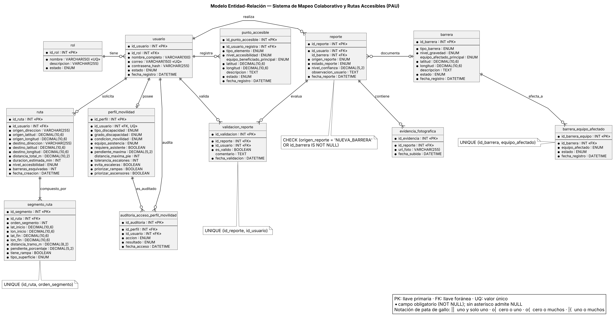

## 3.2 Modelo entidad-relación

La presenta el modelo entidad-relación con notación de pata de gallo. Tiene doce entidades y trece relaciones; las cardinalidades de cada una se detallan en la . Dos casos merecen mención: un usuario tiene como máximo un perfil de movilidad, y un reporte puede no tener barrera asociada cuando su origen es NUEVA_BARRERA, lo que el diccionario controla con una restricción CHECK.

Figura  
*Modelo entidad-relación del sistema PAU*

*Nota.* Elaboración propia a partir del diccionario de datos. Notación de pata de gallo; el punto negro marca los campos obligatorios.

