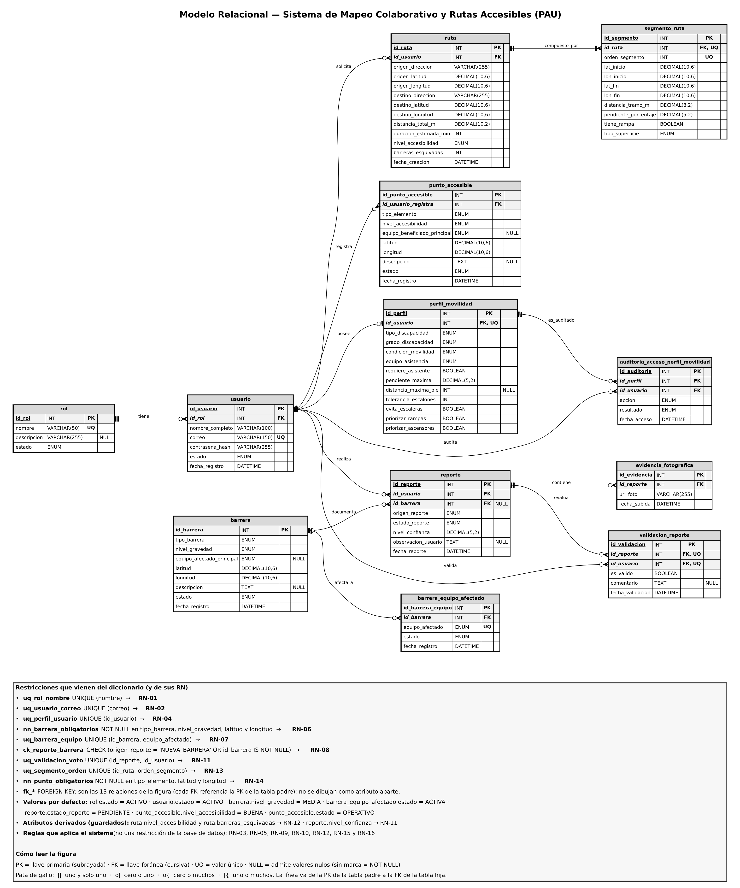

## 3.3 Modelo relacional

La presenta el modelo relacional, obtenido del MER con tres reglas: cada entidad se convierte en una tabla; en cada relación de uno a muchos, la llave primaria de la tabla padre pasa como llave foránea a la tabla hija; y en la relación uno a uno entre usuario y perfil de movilidad, la llave foránea se declara única. Las restricciones UNIQUE, CHECK y NOT NULL, con la regla de negocio de la que provienen, aparecen en el cuadro inferior de la figura.

Figura  
*Modelo relacional del sistema PAU*

*Nota.* Elaboración propia a partir del MER y del diccionario de datos. PK: llave primaria; FK: llave foránea; UQ: valor único.

