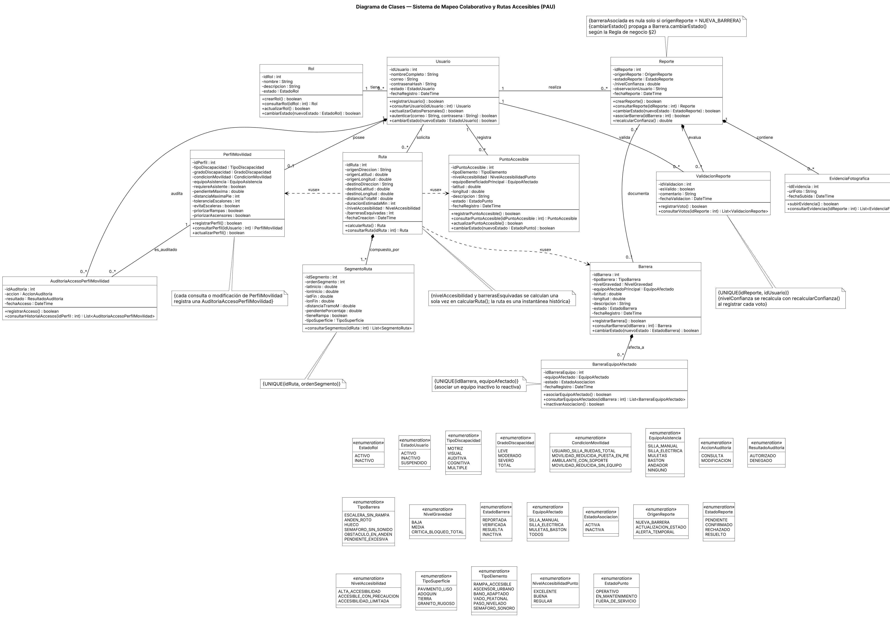

## 3.4 Diagrama de clases

La presenta el diagrama de clases en UML, con doce clases de dominio y veinte enumeraciones. Los atributos son privados y los métodos públicos; los atributos derivados (nivelConfianza, nivelAccesibilidad y barrerasEsquivadas) llevan el prefijo «/». Las llaves foráneas del modelo relacional aparecen como asociaciones con su multiplicidad, no como atributos. Las 36 operaciones de las clases son las que la sección 2.1 convierte en historias de usuario (cada ficha cita la clase y el método, por ejemplo Usuario.registrarUsuario()): 34 tienen historia propia, y recalcularConfianza() y registrarAcceso() son métodos internos que dispara otro método, por lo que no tienen historia propia.

Figura  
*Diagrama de clases del sistema PAU*

*Nota.* Elaboración propia a partir del diccionario de datos y del MER.

