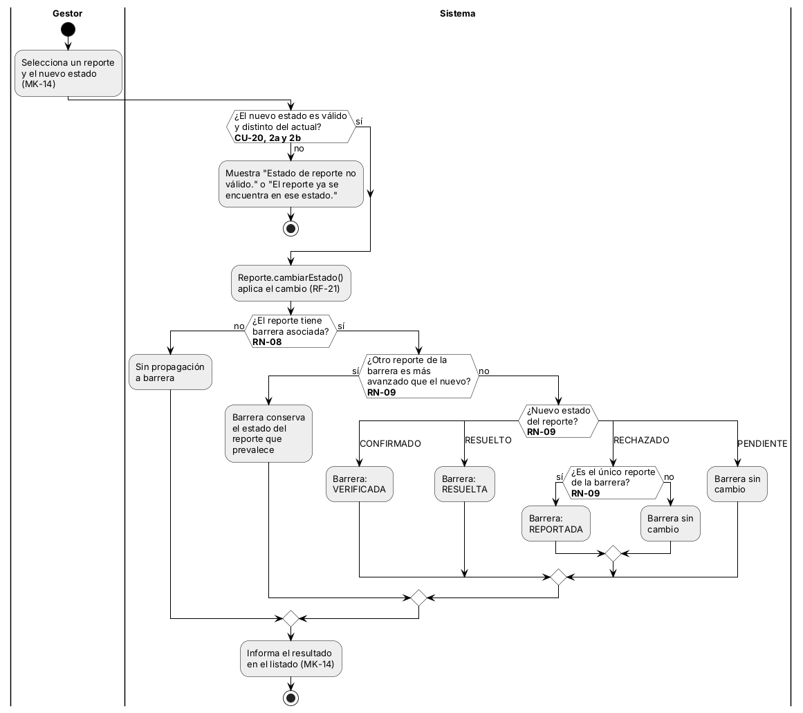
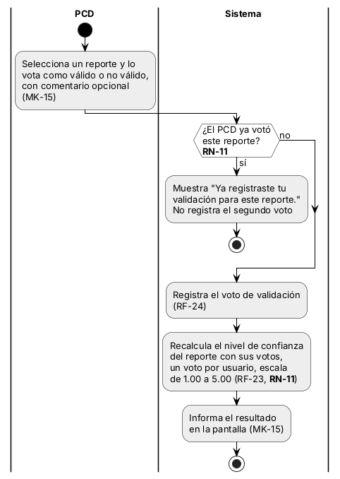
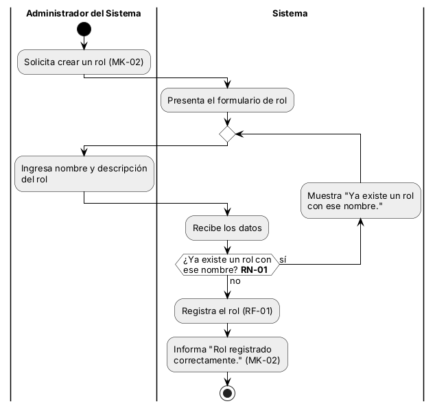
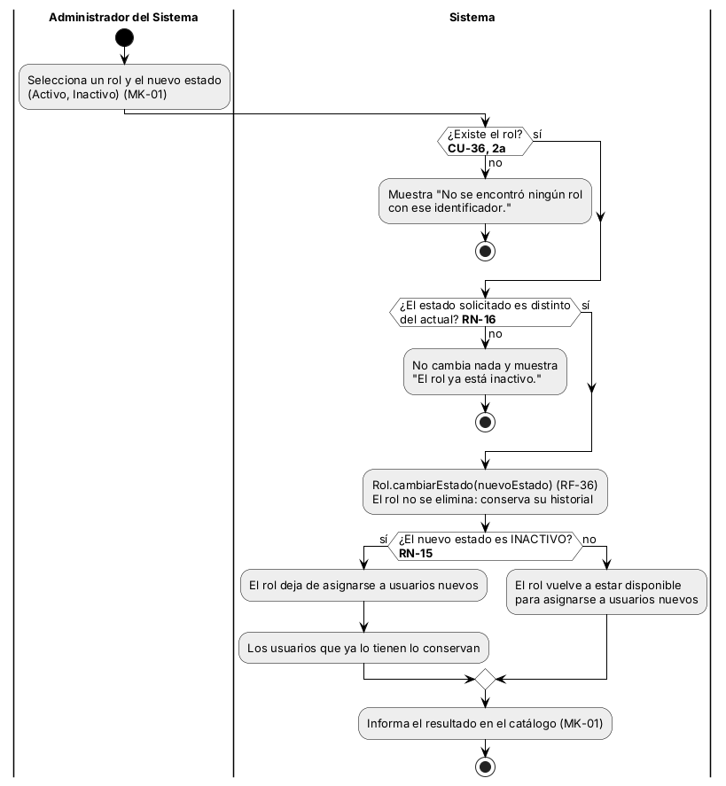

## 3.7 Diagrama de actividades

El diagrama de actividades se elaboró para cuatro procesos del sistema: dos críticos, que operan sobre tablas transaccionales (reporte y validacion_reporte), y dos no críticos, que operan sobre una tabla maestra (rol). Un proceso es crítico cuando modifica registros que se generan con el uso del sistema y su resultado afecta a otros datos, como el estado de una barrera o la confianza de un reporte. Un proceso es no crítico cuando mantiene un catálogo y no modifica otras tablas. La resume los cuatro procesos.

Tabla  
*Procesos seleccionados para el diagrama de actividades*

| **Característica** | **Crítico 1**              | **Crítico 2**                      | **No crítico 1**          | **No crítico 2**          |
|--------------------|----------------------------|------------------------------------|---------------------------|---------------------------|
| Proceso            | Cambiar estado del reporte | Registrar voto de validación       | Crear rol                 | Cambiar estado de un rol  |
| CU, HU y RF        | CU-20, HU-20, RF-21        | CU-23, HU-23, RF-24                | CU-01, HU-01, RF-01       | CU-36, HU-36, RF-36       |
| Tabla que modifica | reporte (transaccional)    | validacion_reporte (transaccional) | rol (maestra)             | rol (maestra)             |
| Actor              | Gestor Comunitario         | PCD                                | Administrador del Sistema | Administrador del Sistema |
| Pantalla           | MK-14                      | MK-15                              | MK-02                     | MK-01                     |
| Reglas de negocio  | RN-08 y RN-09              | RN-11                              | RN-01                     | RN-15 y RN-16             |
| Figura             | Figura 28                  | Figura 29                          | Figura 30                 | Figura 31                 |

*Nota.* Elaboración propia a partir de los casos de uso, el diccionario de datos y las reglas de negocio.

### 3.7.1 Procesos críticos (tablas transaccionales)

La describe el CU-20. La tabla reporte es transaccional: sus filas nacen del uso de la plataforma y cambian de estado cuando el Gestor Comunitario las revisa. El Sistema valida el estado solicitado (flujos alternos 2a y 2b), aplica Reporte.cambiarEstado() (RF-21) y, si el reporte tiene barrera asociada (RN-08), propaga el cambio a la barrera con la regla de prevalencia de la RN-09.

Figura  
*Diagrama de actividades del proceso crítico: cambiar estado del reporte (CU-20)*

*Nota.* Elaboración propia a partir del CU-20, la HU-20, la RN-08 y la RN-09. Cada rombo cita la regla o el flujo alterno que decide.

La describe el CU-23. La tabla validacion_reporte es transaccional: cada voto es un registro nuevo que un PCD genera sobre un reporte. El Sistema verifica que el PCD no haya votado ya ese reporte (RN-11); si ya votó, no registra el segundo voto. Si no, registra el voto (RF-24) y recalcula el nivel de confianza del reporte con los votos registrados, contando un voto por usuario (RF-23, RN-11).

Figura  
*Diagrama de actividades del proceso crítico: registrar voto de validación (CU-23)*

*Nota.* Elaboración propia a partir del CU-23, la HU-23, el RF-23 y la RN-11.

### 3.7.2 Procesos no críticos (tabla maestra)

La describe el CU-01. La tabla rol es maestra: es un catálogo pequeño del que dependen los usuarios. Mientras el nombre ingresado ya exista en el catálogo (RN-01), el Sistema lo rechaza y el Administrador del Sistema vuelve a ingresar los datos; cuando el nombre es nuevo, registra el rol (RF-01) e informa el resultado.

Figura  
*Diagrama de actividades del proceso no crítico: crear rol (CU-01)*

*Nota.* Elaboración propia a partir del CU-01, la HU-01 y la RN-01.

La describe el CU-36, sobre la misma tabla maestra. El Sistema verifica que el rol exista (flujo alterno 2a) y que el estado solicitado sea distinto del actual (RN-16), y aplica Rol.cambiarEstado() (RF-36). El rol no se elimina: si queda INACTIVO, deja de asignarse a usuarios nuevos y quienes ya lo tienen lo conservan (RN-15).

Figura  
*Diagrama de actividades del proceso no crítico: cambiar estado de un rol (CU-36)*

*Nota.* Elaboración propia a partir del CU-36, la HU-36, la RN-15 y la RN-16. El rol no se elimina: se inactiva y conserva su historial.

