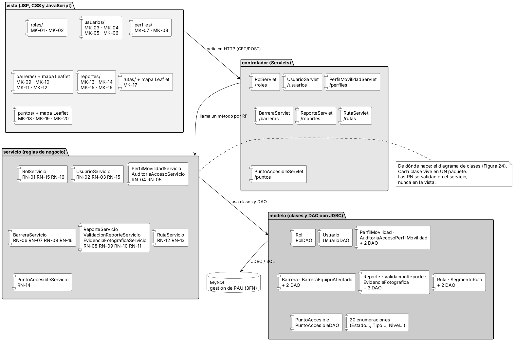

## 3.8 Documento de diseño arquitectónico (DDA)

El documento de diseño arquitectónico (DDA) define cómo se organiza el código del sistema antes de escribirlo. El proyecto PAU se desarrollará con el patrón Modelo-Vista-Controlador sin framework. El backend usa Java, con Servlets y JSP para la capa web y JDBC para la conexión a la base de datos MySQL, que sigue el diccionario de datos en 3FN. Las vistas usan HTML, CSS y JavaScript, y los mapas se construyen con la librería Leaflet sobre OpenStreetMap. El control de versiones se lleva con Git y GitHub. La muestra los cuatro paquetes (vista, controlador, servicio y modelo) y, en cada fila, el módulo que los recorre desde la pantalla hasta la tabla. Cada fila conserva la trazabilidad: las pantallas son los mockups MK, el Servlet atiende sus botones, el servicio valida las reglas de negocio RN y el modelo reúne las clases del diagrama de clases con su acceso a datos.

Figura  
*Arquitectura MVC y distribución de paquetes del sistema PAU*

*Nota.* Elaboración propia a partir del diagrama de clases, los mockups MK, los requisitos funcionales y las reglas de negocio.

El paquete vista contiene las páginas JSP de las veinte pantallas, una por mockup, agrupadas en carpetas por módulo, junto con los archivos CSS y JavaScript; las pantallas de barreras, rutas y puntos accesibles muestran el mapa con Leaflet sobre OpenStreetMap. El paquete controlador tiene siete Servlets que reciben las peticiones HTTP; cada método atiende un requisito funcional y no contiene reglas de negocio. El paquete servicio concentra las dieciséis reglas de negocio (RN-01 a RN-16): se validan allí, nunca en la vista. Algunos servicios colaboran entre sí: UsuarioServicio consulta a RolServicio para verificar que el rol esté activo (RN-15), ReporteServicio propaga el cambio de estado a BarreraServicio (RN-09) y PerfilMovilidadServicio registra cada acceso mediante AuditoriaAccesoServicio (RN-05).

El paquete modelo reúne las doce clases del diagrama de clases, un objeto de acceso a datos (DAO) por clase y las veinte enumeraciones: EstadoRol, EstadoUsuario, TipoDiscapacidad, GradoDiscapacidad, CondicionMovilidad, EquipoAsistencia, AccionAuditoria, ResultadoAuditoria, TipoBarrera, NivelGravedad, EstadoBarrera, EquipoAfectado, EstadoAsociacion, OrigenReporte, EstadoReporte, NivelAccesibilidad, TipoSuperficie, TipoElemento, NivelAccesibilidadPunto y EstadoPunto. Cada clase vive en un solo paquete, y los DAO son los únicos que se comunican con la base de datos, mediante JDBC y sentencias SQL.

