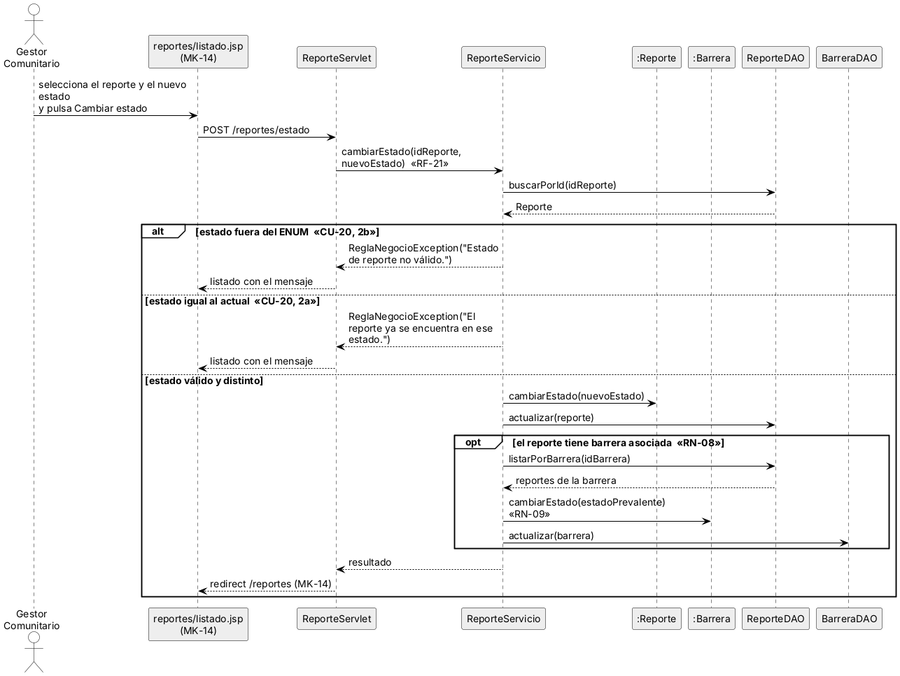
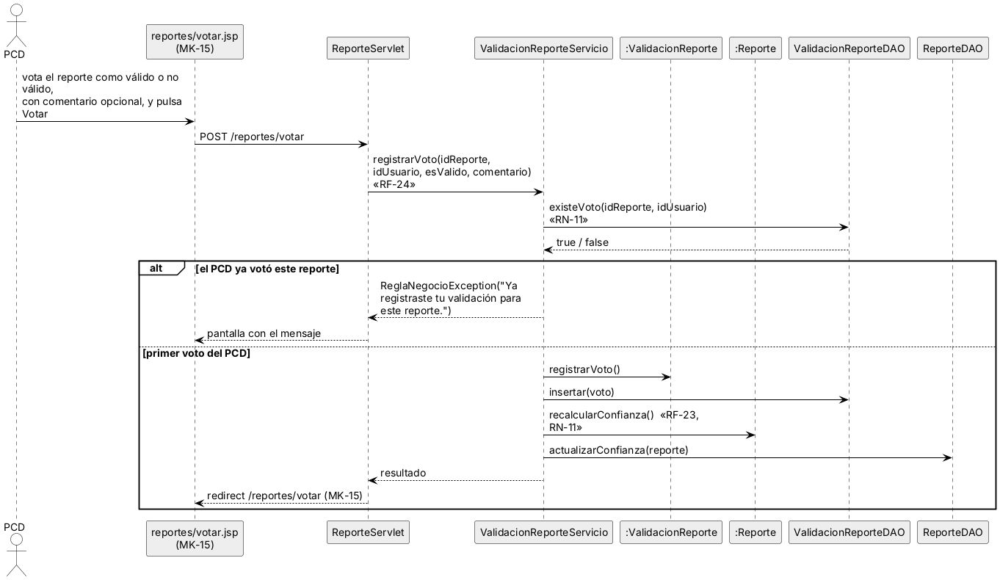
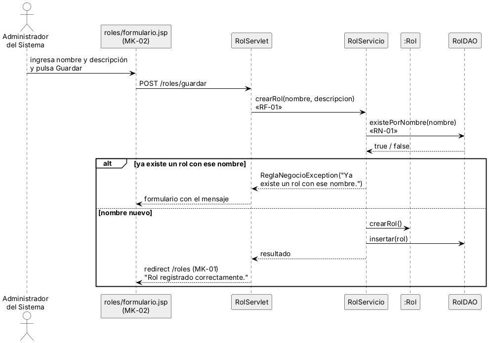
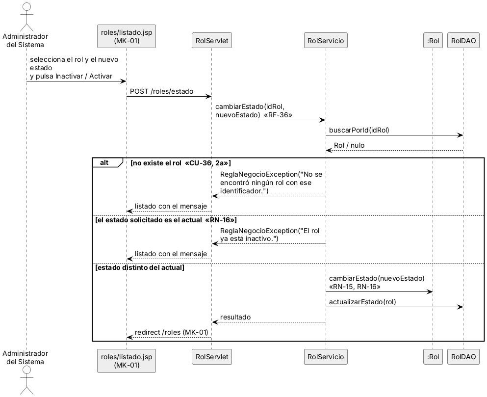

## 3.9 Diagramas de secuencia

Los diagramas de secuencia se elaboran sobre los mismos cuatro procesos del diagrama de actividades, porque nacen de sus casos de uso (CU-20, CU-23, CU-01 y CU-36) y del DDA: el actor interactúa con la página JSP, que envía la petición al Servlet; el Servlet llama al servicio y el servicio valida la regla de negocio, usa los objetos del modelo y los DAO. Las figuras 33 a 36 presentan los cuatro diagramas. La regla de oro es que ningún mensaje invoque un método que no exista en el diagrama de clases de la . La lista los mensajes dirigidos a las clases del dominio y el método que les corresponde en ese diagrama. Los métodos de los DAO (buscarPorId, insertar, actualizar) pertenecen a la capa de acceso a datos del paquete modelo y no se dibujan en el diagrama de clases.

Tabla  
*Mensajes a las clases del dominio y su método en el diagrama de clases*

| **Clase**         | **Método**                 | **Proceso (CU, RF, RN)**   | **Figura** |
|-------------------|----------------------------|----------------------------|------------|
| Reporte           | cambiarEstado(nuevoEstado) | CU-20, RF-21               | Figura 33  |
| Barrera           | cambiarEstado(nuevoEstado) | CU-20, RN-09 (propagación) | Figura 33  |
| ValidacionReporte | registrarVoto()            | CU-23, RF-24, RN-11        | Figura 34  |
| Reporte           | recalcularConfianza()      | CU-23, RF-23, RN-11        | Figura 34  |
| Rol               | crearRol()                 | CU-01, RF-01, RN-01        | Figura 35  |
| Rol               | cambiarEstado(nuevoEstado) | CU-36, RF-36, RN-15, RN-16 | Figura 36  |

*Nota.* Elaboración propia a partir del diagrama de clases y de los diagramas de secuencia.

Figura  
*Diagrama de secuencia del proceso crítico: cambiar estado del reporte (CU-20)*

*Nota.* Elaboración propia a partir del CU-20, el DDA y el diagrama de clases. Cada mensaje a una clase del dominio existe en ese diagrama.

Figura  
*Diagrama de secuencia del proceso crítico: registrar voto de validación (CU-23)*

*Nota.* Elaboración propia a partir del CU-23, el DDA y el diagrama de clases.

Figura  
*Diagrama de secuencia del proceso no crítico: crear rol (CU-01)*

*Nota.* Elaboración propia a partir del CU-01, el DDA y el diagrama de clases.

Figura  
*Diagrama de secuencia del proceso no crítico: cambiar estado de un rol (CU-36)*

*Nota.* Elaboración propia a partir del CU-36, el DDA y el diagrama de clases.

