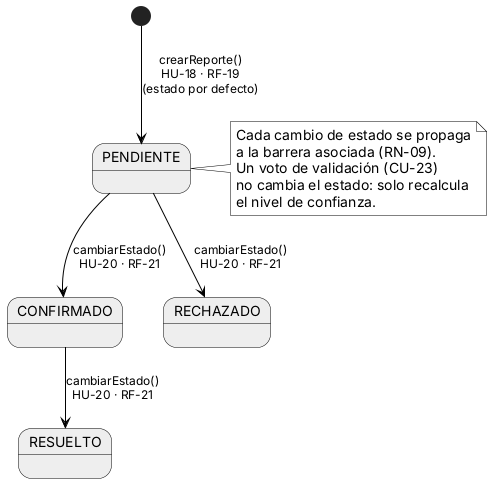
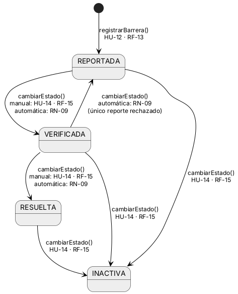
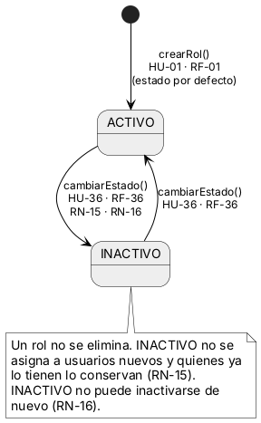
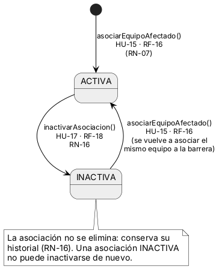

## 3.10 Diagrama de estados

El diagrama de estados se hace sobre las entidades con un campo de estado (ENUM) que los cuatro procesos modifican. El CU-20 cambia el estado de dos entidades, el reporte y la barrera, porque propaga el cambio (RN-09); el CU-01 y el CU-36 recorren el ciclo de vida del rol. El CU-23 (registrar voto de validación) no genera un diagrama propio: la tabla validacion_reporte no tiene campo de estado, y el voto solo recalcula el nivel de confianza del reporte, que es un atributo derivado. Por eso son tres diagramas para estos procesos: reporte (), barrera () y rol (). Se agrega un cuarto, la asociación entre una barrera y un equipo afectado (), porque es la otra entidad que se da de baja por inactivación (RN-16) y se relaciona con la barrera. Ningún registro se elimina: cambia de estado. La indica, para cada transición, el método, el gestor (HU y RF) y si es manual o automática; las automáticas se justifican con la regla de negocio que las dispara.

Tabla  
*Transiciones de estado y su gestor*

| **Entidad**               | **Transición**                              | **Gestor**    | **Tipo**               | **Regla o justificación**                       |
|---------------------------|---------------------------------------------|---------------|------------------------|-------------------------------------------------|
| Reporte                   | inicio → PENDIENTE                          | HU-18 · RF-19 | Manual (PCD)           | Estado por defecto del diccionario              |
| Reporte                   | PENDIENTE → CONFIRMADO                      | HU-20 · RF-21 | Manual (Gestor)        | RN-09: la barrera pasa a VERIFICADA             |
| Reporte                   | PENDIENTE → RECHAZADO                       | HU-20 · RF-21 | Manual (Gestor)        | RN-09: la barrera no cambia                     |
| Reporte                   | CONFIRMADO → RESUELTO                       | HU-20 · RF-21 | Manual (Gestor)        | RN-09: la barrera pasa a RESUELTA               |
| Barrera                   | inicio → REPORTADA                          | HU-12 · RF-13 | Manual (Gestor)        | Estado inicial al registrar (HU-12)             |
| Barrera                   | REPORTADA → VERIFICADA                      | HU-14 · RF-15 | Manual o automática    | Automática por RN-09 al confirmarse un reporte  |
| Barrera                   | VERIFICADA → RESUELTA                       | HU-14 · RF-15 | Manual o automática    | Automática por RN-09 al resolverse un reporte   |
| Barrera                   | VERIFICADA → REPORTADA                      | HU-14 · RF-15 | Automática             | RN-09: rechazo del único reporte                |
| Barrera                   | REPORTADA, VERIFICADA o RESUELTA → INACTIVA | HU-14 · RF-15 | Manual (Gestor)        | Baja por inactivación                           |
| Rol                       | inicio → ACTIVO                             | HU-01 · RF-01 | Manual (Administrador) | Estado por defecto del diccionario              |
| Rol                       | ACTIVO → INACTIVO                           | HU-36 · RF-36 | Manual (Administrador) | RN-15 y RN-16                                   |
| Rol                       | INACTIVO → ACTIVO                           | HU-36 · RF-36 | Manual (Administrador) | Reactivación del rol                            |
| Asociación barrera–equipo | inicio → ACTIVA                             | HU-15 · RF-16 | Manual (Gestor)        | RN-07: un equipo por barrera                    |
| Asociación barrera–equipo | ACTIVA → INACTIVA                           | HU-17 · RF-18 | Manual (Gestor)        | RN-16: baja por inactivación                    |
| Asociación barrera–equipo | INACTIVA → ACTIVA                           | HU-15 · RF-16 | Manual (Gestor)        | Se reactiva al volver a asociar el mismo equipo |

*Nota.* Elaboración propia a partir del diccionario de datos, las historias de usuario y las reglas de negocio.

Figura  
*Diagrama de estados del reporte (EstadoReporte)*

*Nota.* Elaboración propia a partir del diccionario de datos, la HU-20 y la RN-09.

Figura  
*Diagrama de estados de la barrera (EstadoBarrera)*

*Nota.* Elaboración propia a partir del diccionario de datos, la HU-14 y la RN-09.

Figura  
*Diagrama de estados del rol (EstadoRol)*

*Nota.* Elaboración propia a partir del diccionario de datos, la HU-36, la RN-15 y la RN-16.

Figura  
*Diagrama de estados de la asociación barrera–equipo afectado (EstadoAsociacion)*

*Nota.* Elaboración propia a partir del diccionario de datos, la HU-15, la HU-17 y la RN-16.

