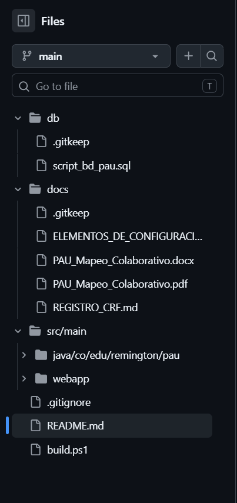
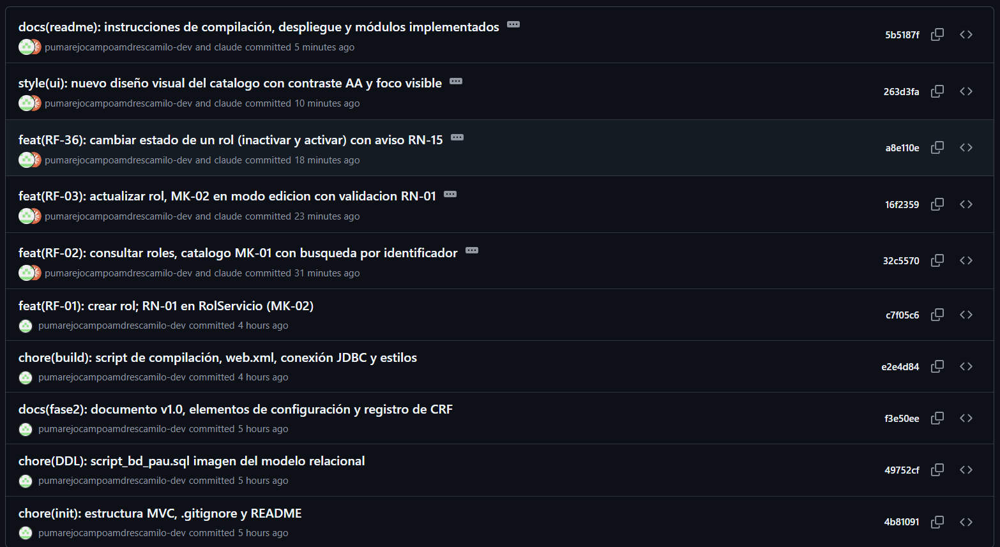

## 4.2 Repositorio Git

El código y los documentos del proyecto viven en un repositorio Git alojado en GitHub: https://github.com/pumarejocampoamdrescamilo-dev/pau-mapeo-colaborativo. Su estructura es la imagen del DDA de la : una carpeta por paquete y una carpeta de vistas por módulo. La resume el contenido de cada carpeta y la muestra el resultado en GitHub.

Tabla  
*Estructura del repositorio y su origen en el DDA*

| **Carpeta**                                                                     | **Contenido**                                                                        | **Origen en el DDA**                      |
|---------------------------------------------------------------------------------|--------------------------------------------------------------------------------------|-------------------------------------------|
| db/                                                                             | script_bd_pau.sql, con cabecera de historial                                         | Modelo relacional y diccionario de datos  |
| docs/                                                                           | Documento del proyecto (PDF y Word), ELEMENTOS_DE_CONFIGURACION.md y REGISTRO_CRF.md | Entregables y gestión de la configuración |
| src/main/java/.../modelo                                                        | Clases del dominio, enumeraciones y DAO con JDBC                                     | Paquete modelo                            |
| src/main/java/.../servicio                                                      | Servicios con las reglas de negocio                                                  | Paquete servicio                          |
| src/main/java/.../controlador                                                   | Servlets, uno por módulo                                                             | Paquete controlador                       |
| src/main/webapp/ (roles, usuarios, perfiles, barreras, reportes, rutas, puntos) | Vistas JSP por módulo, con los mapas Leaflet donde aplica                            | Paquete vista y mockups MK-01 a MK-20     |
| src/main/webapp/css y js                                                        | Estilos y JavaScript compartidos                                                     | Paquete vista                             |

*Nota.* Elaboración propia a partir del DDA de la sección 3.8.

El archivo .gitignore deja fuera todo lo que se puede regenerar o que no debe compartirse. La clave de la base de datos nunca se escribe en el código: la conexión JDBC la lee de las variables de entorno PAU_DB_URL, PAU_DB_USER y PAU_DB_PASSWORD. La explica cada exclusión.

Tabla  
*Elementos excluidos del repositorio con .gitignore*

| **Excluido**                                                   | **Motivo**                                                                                  |
|----------------------------------------------------------------|---------------------------------------------------------------------------------------------|
| target/, build/, out/, \*.class, \*.war, \*.jar                | Compilados y paquetes: se regeneran al construir el proyecto                                |
| .idea/, .vscode/, .settings/, .classpath, .project, nbproject/ | Configuración personal del editor de cada integrante                                        |
| .env, db.properties, application-local.properties              | Credenciales y configuración local: la clave de la base de datos va por variable de entorno |
| \*.log, \*.tmp, Thumbs.db, .DS_Store                           | Registros y temporales del sistema operativo                                                |

*Nota.* Elaboración propia.

El trabajo sigue una convención sencilla: todo el desarrollo se integra en la rama main y se hace un commit por requisito funcional, en el orden de la matriz de trazabilidad, con el mensaje tipo(código): descripción, donde el tipo es feat, chore, docs o style y el código es el del requisito (por ejemplo feat(RF-01)). La muestra el historial real. El tag LB-1 se crea al terminar el código: congela el documento v1.0 junto con el repositorio, y desde entonces todo cambio entra por una solicitud de cambio (CRF), que se registra en docs/REGISTRO_CRF.md. Los comandos para crear el repositorio y el tag son estos:

> git init -b main
>
> git add .
>
> git commit -m "chore(init): estructura MVC, .gitignore y README"
>
> git remote add origin https://github.com/pumarejocampoamdrescamilo-dev/pau-mapeo-colaborativo.git
>
> git push -u origin main
>
> git tag -a LB-1 -m "Linea Base 1: documento v1.0 + repo. Todo cambio posterior entra por CRF."
>
> git push origin LB-1

Figura  
*Estructura del repositorio en GitHub*

*Nota.* Captura del árbol de archivos del repositorio pau-mapeo-colaborativo en GitHub.

Figura  
*Historial de commits del repositorio*

*Nota.* Captura de la lista de commits en GitHub: un commit por requisito funcional, con el formato tipo(código): descripción.

