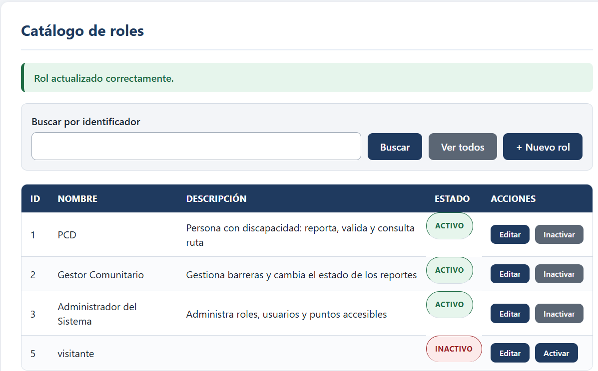
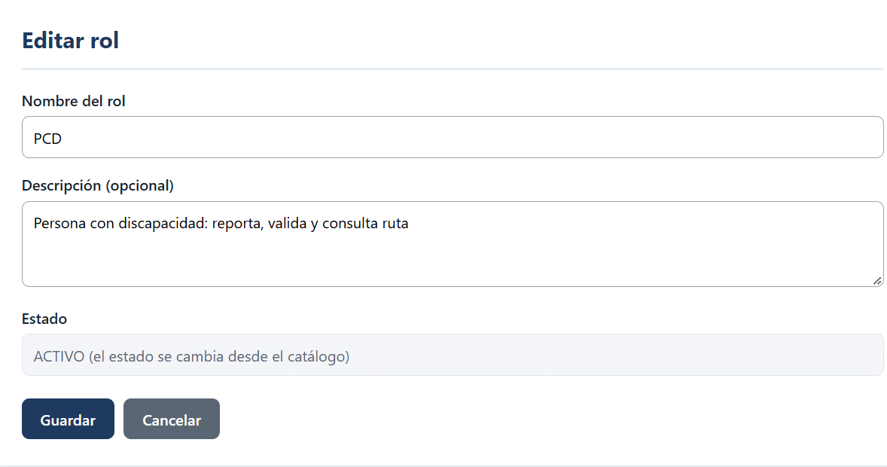
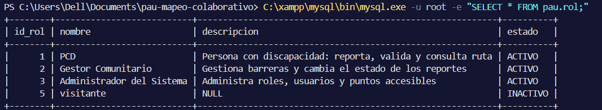

## 4.3 Código MVC

El código se construye por módulos, siguiendo el orden de la matriz de trazabilidad y con un commit por requisito. El primer módulo es el de roles: es la entidad maestra más simple y recorre las cuatro capas del patrón, por lo que sirve para comprobar el recorrido completo antes de repetirlo en los demás módulos. La compilación y el despliegue se hacen sin framework: javac con las librerías del conector MySQL y de JSTL, y Apache Tomcat 10.1 como contenedor de Servlets y JSP.

Cada requisito recorre el mismo camino. La vista JSP muestra los datos y no contiene reglas. El Servlet RolServlet recibe la petición, lee los parámetros y decide a quién llamar. El servicio RolServicio aplica las reglas de negocio: RN-01 (el nombre del rol no se repite, tanto al crear como al actualizar frente a los demás roles) y RN-16 (un rol nunca se elimina, solo se inactiva). El modelo reúne la clase Rol, con los métodos crearRol, consultarRol, actualizarRol y cambiarEstado del diagrama de clases, y el DAO RolDAO, que ejecuta las sentencias SQL con JDBC y consultas parametrizadas. La relaciona cada requisito con su commit, sus métodos y su pantalla.

Tabla  
*Requisitos del módulo de roles y su implementación*

| **Requisito**                  | **Commit** | **Métodos agregados (dominio, servicio y DAO)**                                                    | **Pantalla y ruta**  |
|--------------------------------|------------|----------------------------------------------------------------------------------------------------|----------------------|
| RF-01 Crear rol                | c7f05c6    | Rol.crearRol(); RolServicio.crearRol(); RolDAO.existePorNombre() e insertar()                      | MK-02, /roles/nuevo  |
| RF-02 Consultar roles          | 32c5570    | Rol.consultarRol(int); RolServicio.consultarRol() y listarRoles(); RolDAO.buscarPorId() y listar() | MK-01, /roles        |
| RF-03 Actualizar rol           | 16f2359    | Rol.actualizarRol(); RolServicio.actualizarRol(); RolDAO.existeOtroConNombre() y actualizar()      | MK-02, /roles/editar |
| RF-36 Cambiar estado de un rol | a8e110e    | Rol.cambiarEstado(EstadoRol); RolServicio.cambiarEstado(); RolDAO.actualizarEstado()               | MK-01, /roles/estado |

*Nota.* Elaboración propia a partir de la matriz de trazabilidad (sección 3.11) y del historial del repositorio.

La muestra el catálogo de roles de la pantalla MK-01: lista todos los roles y permite buscar uno por su identificador (RF-02). Si el identificador no existe, el sistema responde «No se encontró ningún rol con ese identificador.». Desde la misma pantalla se inactiva un rol con un aviso que explica la consecuencia de RN-15 (un rol inactivo no se asigna a usuarios nuevos y quienes ya lo tienen lo conservan) y se vuelve a activar (RF-36). En la imagen se ve el rol visitante inactivo y el mensaje que confirma la actualización de un rol.

Figura  
*Catálogo de roles con el mensaje de actualización*

*Nota.* Captura del navegador sobre Tomcat 10.1 (MK-01). Muestra RF-02, el mensaje de RF-03 y el estado de RF-36.

La muestra la pantalla MK-02 en modo edición (RF-03): el formulario trae los datos actuales del rol, el estado se muestra solo de lectura porque se cambia desde el catálogo, y al guardar un nombre que ya usa otro rol el sistema responde «Ya existe un rol con ese nombre.» (RN-01). Al guardar un nombre libre responde «Rol actualizado correctamente.».

Figura  
*Formulario en modo Editar rol*

*Nota.* Captura del navegador (MK-02 en modo edición, RF-03). El estado aparece solo de lectura.

La comprueba que los cambios llegaron a la base de datos: la tabla rol conserva los cuatro roles y el rol visitante quedó en estado INACTIVO sin haber sido eliminado, como exige RN-16.

Figura  
*Contenido de la tabla rol en la base de datos*

*Nota.* Captura de la consola de MariaDB (XAMPP) con SELECT \* FROM pau.rol; después de inactivar el rol visitante.

Con estos cuatro requisitos el CRUD de la entidad Rol funciona de punta a punta, desde la pantalla hasta la base de datos. Los demás módulos siguen el mismo patrón y se registran en el repositorio con un commit por requisito.

